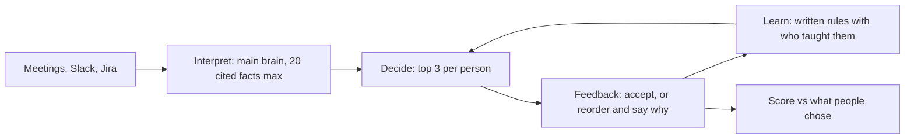

# WorkflowGPS

**One shared direction. Three clear next steps.** An agent that gives each person on a team their top three priorities every day, learns the team's unwritten rules from their corrections, and gets measurably better at it.

Built at SEP Hacks 2026 (LA Tech Week) for the Continual Learning theme.

- **Live app:** https://continual-learning-agent-sep-hacks.onrender.com (Demo and Live tabs; the free server may take a minute to wake up)
- **Live app with Demo:** [https://continual-learning-agent-sep-hacks.onrender.com/#live](https://continual-learning-agent-sep-hacks.onrender.com/#live)

## Team

- Ved Chadderwala
- James Shechet
- Dev Mehra
- Jeffrey Au

## Problem

As AI speeds up execution, coordination becomes the bottleneck. Priorities shift every day: a client escalates, a manager sends an urgent DM, two people work on the same thing. The documents say one thing and the team knows another. Everyone re-plans alone, from scattered meetings, Slack and Jira.

## Solution

Every morning, WorkflowGPS reads the team's meetings, Slack and Jira, keeps one shared **main brain** of where things stand against the mission and goals, and gives each person **three stops** for the day: an action or a decision, each with a time box, a reason and the source it came from.

People accept the plan, or reorder it and say why in one sentence. The agent turns each reason into a written **rule**, like *"When a customer escalates, only the on-call engineer takes the fix; everyone else keeps their plan,"* and applies it from the next day on. Every rule shows who taught it.



## Results

A fictional 6-person startup (Tidewell) over 8 working days, 58 tickets. Each person's true priorities depend on facts the documents never state, such as a key customer quietly weighing a competitor. Days 1 and 2 were used for development. **Days 3 to 8 were held out: prompts were frozen before the agent saw them.** We ran the same 8 days with learning on and off.

| | Without learning | With learning |
| --- | --- | --- |
| Agreement, held-out days 3 to 8 | 73.2 | **85.9** |
| Agreement, days 2 to 8 | 72.0 | **85.9** |
| Corrections needed, days 2 to 8 | 25 | **15** (40% fewer) |
| Day 6: new escalation, new on-call engineer | 54.2 | **95.8** |
| Day 7: nothing new to apply (control) | 95.8 | 95.8 |

Agreement compares the agent's top three with the order each person chose: full credit for the same place, half credit for a different place, weighted 3, 2, 1.

Day 6 is the clearest case. The rule was learned on day 3, when Nina was on call. On day 6 a different customer escalated and Arjun was on call. With lessons, the agent sent the fix to Arjun, not Nina: it applied the rule, not the example.

**Weights vs written rules.** We also built a small ranker whose weights update from every correction (`baselines/ranker.py`, no API calls). It learned "Harbor matters" just as fast (90.3 on day 2), but it can't read reasons. On escalation days it learned the wrong lesson, "Coastal tickets are bad" (weight 0 to -2.6), and scored 59.7 on day 6. Weights learn *what* people chose; written rules learn *why*.

## How we addressed each track

### Grand Tech: Continual Learning
- **Gets better the more people use it:** every correction becomes a rule used from the next day on. On the held-out days 3 to 8, agreement rose from 73.2 to 85.9, against the same agent with learning off.
- **Learning is the core, not an add-on:** the comparison above isolates it. Day 1 is identical in both runs, and the brain is built the same way in both, so the only difference is the rules.
- **Solves what a non-learning product couldn't:** the facts that matter (who takes escalations, which customer matters this month) are not in any document. They live in people's heads and arrive as corrections.
- **More valuable as it scales:** rules accumulate per team and transfer between people. The escalation rule taught by Arjun and Nina on day 3 shaped Leila's plan on day 6, and she accepted it as proposed.

### Agent Behaviour Monitoring
- **What counts as a failure:** hard (an output that breaks its contract: unknown tickets, citations to sources that don't exist, time boxes over 8 hours, cut-off replies), soft (a rejected plan, a drop in agreement), silent (a rule that keeps getting overridden, or two rules that conflict).
- **How it notices on its own:** every model output is parsed and checked against the real data. On a failed check it retries once with the exact errors; if that fails, it stops, saves the raw reply and names the step. It never guesses. A truncated reply, detected by the model's stop reason, stops the run immediately and is never cached. This came from a real incident: on day 3 the planner ran out of output tokens mid-plan.
- **Alerts:** it flags rejected plans, day-over-day drops of 15+ points, and rules people keep overriding, in `runs/<run>/day_NN/health.json`.
- **Guardrails:** it only proposes; people approve. The hidden facts behind each person's choices never reach the model (blocked in code and enforced by a test); only what a real person would say, their corrected order and reason, reaches Learn, after scoring. Day 1 must come out identical with and without learning, which catches leaks. All model calls are cached by input, so runs are reproducible. The public server serves only the UI folder and caps live requests per day.
- **Reliability as it runs longer:** it never re-reads raw history. Each morning it compacts the day into at most 20 cited facts. Our honest failure: on day 8, two learned rules (deadlines first, Harbor first) conflicted, and three people corrected the plan. Next: expiry dates on rules and a conflict check when a rule is written.

### Best Visual Design
- **Three things, nothing else.** Each person sees three stops, drawn as a route, because a plan is an order and a direction.
- When someone corrects their plan, the route visibly **reroutes** into their order, and their reason appears in their own words.
- **Decisions** others wait on are drawn as diamonds, **actions** as circles.
- One accent color, used only for the route and for what the agent learned. History shows **only changes**, with revised words marked.
- The day marker is a route sign set in Overpass, a typeface descended from US highway signage.
- Every message in each person's thread comes from the actual run. Works with the keyboard, on a phone, in dark mode, and with reduced motion.

### Most Scalable to $1B
- **Wedge:** teams of 5 to 50 on Slack and Jira, priced per seat, with value in week one.
- **Moat:** every correction becomes a rule the team owns, so the product gets better and harder to replace the longer a team uses it.
- **Expansion:** from one team to the company, where one agent can see conflicting priorities across teams. Then the decision queue: as AI agents take over execution, the bottleneck is humans deciding.
- **Value:** for a 20-person team, saving one hour per person per week is about $48,000 a year at $50 an hour over 48 weeks.

## AI component

- **Model:** Claude Sonnet 5.5 through the Anthropic API, in up to three calls per day, excluding retries: Interpret (compact the day into the main brain), Decide (top 3 per person with time boxes, reasons and citations), and Learn (turn corrections into rules), which runs only when learning is on and someone corrected their plan.
- **Technique:** continual learning through written memory rather than weight updates. It learns from a single sentence, every rule is auditable and names who taught it, and base skills can't be forgotten. Every output is validated against the data before anyone sees it.

## How we built it

- Python, about 1,300 lines including tests: pydantic schemas, the Anthropic SDK, a disk cache keyed on the full prompt, and a standard-library HTTP server for the Live tab. No agent framework.
- The UI is one HTML file with no build step, exported from real run files (`ui/export.py`).
- Deployed on Render. The demo replays are served from the committed cache, so they're instant and free.
- Constraint we held ourselves to: the test days stayed untouched. When the day 3 run failed from token exhaustion, we fixed the limit and added truncation detection, not the prompts or the data.

## Key files

| File | What it is |
| --- | --- |
| `prompts/interpret.md`, `prompts/decide.md`, `prompts/learn.md` | The three prompts, frozen before the test days |
| `agent/steps.py` | Interpret, Decide, Learn, and their output checks |
| `agent/llm.py` | Model calls: leak guard, cache, validation, retry, truncation detection |
| `agent/evaluate.py` | Simulated feedback and scoring |
| `agent/serve.py` | Live server for the UI |
| `ui/index.html` | The whole interface |
| `baselines/ranker.py` | Weight-learning baseline |
| `data/` | Purpose, history, 8 days, and the held-out answers in `data/eval/` |
| `runs/learn`, `runs/nolearn` | Every plan, brain, rule and score from both runs |
| `PROMPT.md` | The build spec we worked from |

## Run it

```bash
pip install -r requirements.txt
cp .env.example .env            # add ANTHROPIC_API_KEY
python -m agent validate
python -m agent run --mode nolearn
python -m agent run --mode learn
python -m agent report nolearn learn
python baselines/ranker.py
python ui/export.py
python -m agent serve           # then open localhost:8000
pytest
```

With the committed cache, the two runs replay without new API calls.

## Limitations, honestly

- The company and its data are synthetic. The test days and the ranker's features were written with AI assistance by the same person who built the agent, so this is a proof of the mechanism, not a field result.
- LLM output varies between runs. Three additional complete runs per mode are in `runs/`. Across these runs, average agreement on held-out days 3–8 was 74.1 without learning (range 72.4–75.9) and 85.2 with learning (range 84.0–86.6). Each range spans the three run averages.
- Our 8 days of data total about 7,000 tokens, so the bounded brain doesn't save much here. It matters at real scale, where one 30-minute meeting transcript is about 4,500 words.
- Decision vs action labels come from ticket titles and are display only.
- A teammate also built a larger planning benchmark (6 organizations, calendars and coordination). It tests a different skill, calendar-feasible scheduling, so we used its item-acceptance metric and failure taxonomy rather than its data.
